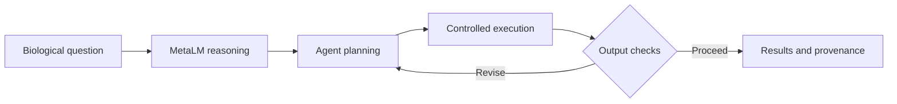

RESEARCH AT UM6P · COLLEGE OF COMPUTING · BIOINFORMATICS LABORATORY

# MetaLM

### From biological questions to executable science.

**A metagenomics-specialized language model and an execution-grounded agentic research framework.**

  

  

## A different way to approach metagenomic analysis

A biological question rarely arrives with a ready-made pipeline. Between raw sequencing data and a scientific conclusion lie tool choices, parameter decisions, dependencies, execution failures, and interpretation. **MetaLM investigates whether specialized language models can help bridge that gap**, not simply by writing code, but by working within an agentic system that executes and inspects computational analyses.

**Our research question:** Can domain knowledge and execution feedback bring natural-language scientific intent closer to reproducible computational results?
  

## The research ecosystem

| Explore                            | Research component | What it is preparing                                          |
| :--------------------------------- | :----------------- | :------------------------------------------------------------ |
| [**01 · Dataset**](dataset/)       | **MetaGen-Inst**   | Curated metagenomics instruction data and curation resources. |
| [**02 · Model**](model/)           | **MetaLM**         | Specialized model adapters and inference resources.           |
| [**03 · Agent**](agent/)           | **MetaLM-Agent**   | Planning, execution, validation, and workflow orchestration.  |
| [**04 · Benchmarks**](benchmarks/) | **Evaluation**     | Model-level and publication-anchored evaluation materials.    |
| [**05 · Examples**](examples/)     | **Case studies**   | Reproducible analysis walkthroughs and example outputs.       |
| [**06 · Docs**](docs/)             | **Guides**         | Architecture, installation, and research documentation.       |
| [**07 · Scripts**](scripts/)       | **Utilities**      | Setup, validation, and reproducibility helpers.               |

 

## Three components, one scientific workflow

The dataset develops the knowledge base. The model learns domain-relevant patterns. The agent connects that reasoning to computational tools, while maintaining execution records and opportunities for inspection.

The underlying research examines **domain adaptation**, **scientific workflow execution**, and **reproducibility**. It evaluates the specialized model on metagenomics questions and explores the recovery of published findings across short-read resistome analysis, genome-resolved metagenomics, and long-read resistance-gene analysis.

## Release status

This repository is currently a **research preview**. The illustrated section pages explain the planned contents; they are not placeholders for downloadable model weights, datasets, or runnable software. Those materials will be added as they become ready for public release. Dates, licensing, and formal citation details will be announced with the corresponding artifacts.

See the [release roadmap](ROADMAP.md) for the planned repository structure.

## Follow the project

Star the repository to keep it on your radar, or use **Watch → Custom → Releases** on GitHub to follow future releases.

## Research affiliation

**Bioinformatics Laboratory**  
**College of Computing**  
**Mohammed VI Polytechnic University (UM6P)**

Research team: **Genereux Akotenou · Youssef Lamrabi · Achraf El Allali**

<!-- --- -->

<!-- 

**MetaLM** · *Built for metagenomics. Designed for reproducible research.*

 -->
