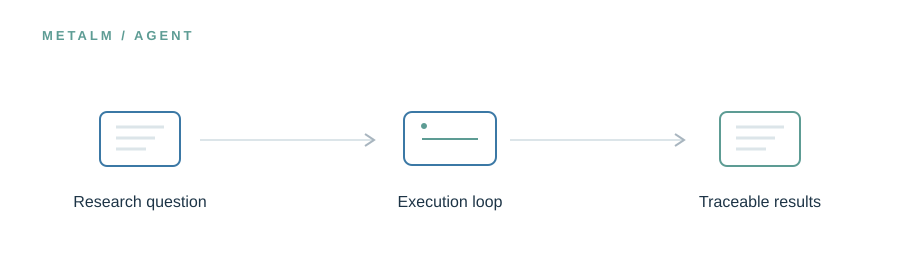

<!-- UM6P · COLLEGE OF COMPUTING · BIOINFORMATICS LABORATORY -->

# MetaLM-Agent

### From scientific intent to an inspectable computational workflow.

**Research preview · Release in preparation**

<!-- --- -->

## The idea

A research question is only the beginning. MetaLM-Agent connects domain reasoning with planning, tool invocation, execution feedback, correction, and reproducible cohort-scale workflows. Its design keeps a record of how results were produced, while recognizing that execution success alone is not scientific validation.

> **In one line:** Research objective → plan and execute → inspect, correct, report.

## What will live here

Agent framework, tool registry, execution configuration, workflow orchestration, and example sessions.

This page introduces the planned research assets. The corresponding files and software are **not yet publicly released in this folder**. Documentation, availability, and licensing will be updated alongside the release.

---

[← Explore the MetaLM project](../README.md) · [Release roadmap](../ROADMAP.md)

<!-- Research at Mohammed VI Polytechnic University (UM6P) · College of Computing · Bioinformatics Laboratory -->
