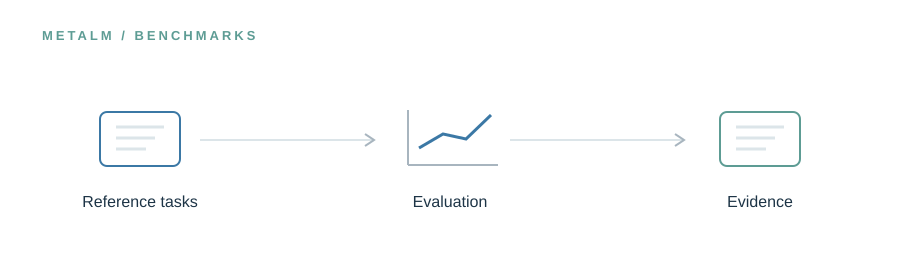

<!-- UM6P · COLLEGE OF COMPUTING · BIOINFORMATICS LABORATORY -->

# Benchmarks

### Measure scientific usefulness, not just plausible text.

**Research preview · Release in preparation**

<!-- --- -->

## The idea

Evaluation should test more than how convincingly a model responds. This space will document metagenomics question answering and execution-grounded analyses, including the distinction between runnable pipelines, recovered biological findings, and repeatability.

> **In one line:** Reference questions → model evaluation → publication-anchored checks.

## What will live here

Benchmark specifications, evaluation scripts, scoring protocols, and reproduction criteria.

This page introduces the planned research assets. The corresponding files and software are **not yet publicly released in this folder**. Documentation, availability, and licensing will be updated alongside the release.

---

[← Explore the MetaLM project](../README.md) · [Release roadmap](../ROADMAP.md)

<!-- Research at Mohammed VI Polytechnic University (UM6P) · College of Computing · Bioinformatics Laboratory -->
