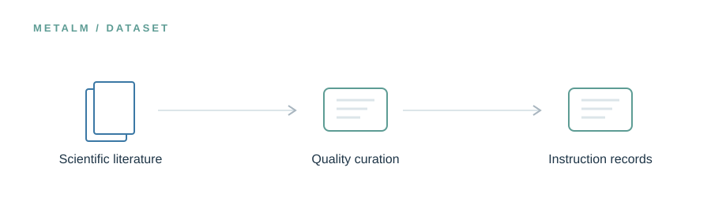

<!-- UM6P · COLLEGE OF COMPUTING · BIOINFORMATICS LABORATORY -->

# MetaGen-Inst

### Turning fragmented expertise into structured scientific knowledge.

**Research preview · Release in preparation**

<!-- --- -->

## The idea

Scientific papers, community discussions, and software troubleshooting each contain a different kind of metagenomic expertise. MetaGen-Inst brings these sources into a curated instruction corpus designed to teach models how to answer questions, reason about workflows, and diagnose technical problems.

> **In one line:** Literature and practitioner knowledge → quality review → metagenomics instructions.

## What will live here

Dataset records, curation methodology, provenance guidance, and data-loading examples.

This page introduces the planned research assets. The corresponding files and software are **not yet publicly released in this folder**. Documentation, availability, and licensing will be updated alongside the release.

---

[← Explore the MetaLM project](../README.md) · [Release roadmap](../ROADMAP.md)

<!-- Research at Mohammed VI Polytechnic University (UM6P) · College of Computing · Bioinformatics Laboratory -->
