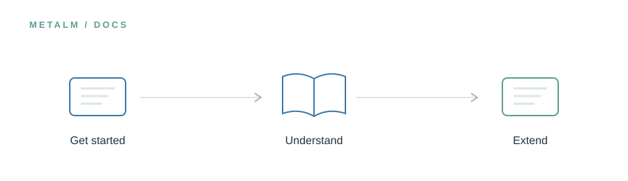

<!-- UM6P · COLLEGE OF COMPUTING · BIOINFORMATICS LABORATORY -->

# Documentation

### Make complex scientific systems understandable.

**Research preview · Release in preparation**

<!-- --- -->

## The idea

Good documentation should expose assumptions, not hide them. This section will explain the MetaLM ecosystem from its conceptual architecture to practical configuration, helping researchers understand what each component does and where human review remains essential.

> **In one line:** Concepts → architecture → practical guidance.

## What will live here

Installation guides, system architecture, component references, FAQs, and limitations.

This page introduces the planned research assets. The corresponding files and software are **not yet publicly released in this folder**. Documentation, availability, and licensing will be updated alongside the release.

---

[← Explore the MetaLM project](../README.md) · [Release roadmap](../ROADMAP.md)

<!-- Research at Mohammed VI Polytechnic University (UM6P) · College of Computing · Bioinformatics Laboratory -->
