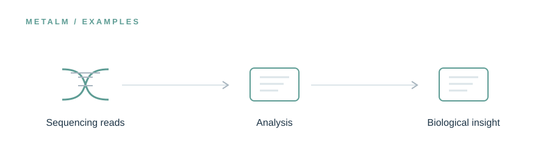

<!-- UM6P · COLLEGE OF COMPUTING · BIOINFORMATICS LABORATORY -->

# Examples

### See how a biological question becomes an analysis.

**Research preview · Release in preparation**

<!-- --- -->

## The idea

The most useful demonstration is one that researchers can inspect from inputs to outputs. This space will present guided examples spanning different metagenomic tasks, with attention to workflow decisions, intermediate files, and provenance.

> **In one line:** Research question → computational workflow → interpretable outputs.

## What will live here

Tutorial datasets or access instructions, example prompts, workflows, and expected output descriptions.

This page introduces the planned research assets. The corresponding files and software are **not yet publicly released in this folder**. Documentation, availability, and licensing will be updated alongside the release.

---

[← Explore the MetaLM project](../README.md) · [Release roadmap](../ROADMAP.md)

<!-- Research at Mohammed VI Polytechnic University (UM6P) · College of Computing · Bioinformatics Laboratory -->
