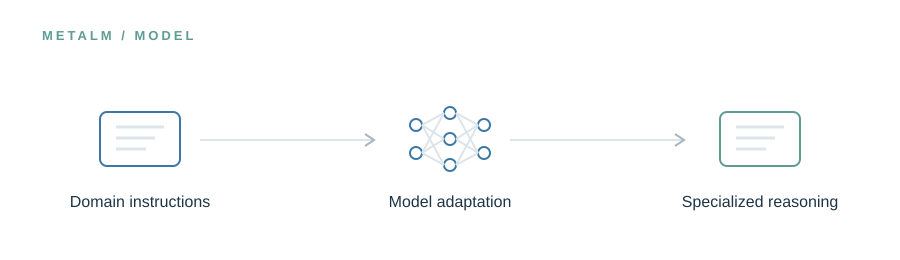

<!-- UM6P · COLLEGE OF COMPUTING · BIOINFORMATICS LABORATORY -->

# MetaLM

### A language model trained to speak the language of metagenomics.

**Research preview · Release in preparation**

<!-- --- -->

## The idea

MetaLM explores what happens when a general-purpose foundation model is adapted to the decisions researchers face in metagenomics: selecting tools, interpreting outputs, troubleshooting errors, and designing analyses. The aim is not a larger model, but more relevant scientific reasoning.

> **In one line:** Curated instructions → domain adaptation → specialized reasoning.

## What will live here

Model adapters, inference instructions, training configurations, and model evaluation details.

This page introduces the planned research assets. The corresponding files and software are **not yet publicly released in this folder**. Documentation, availability, and licensing will be updated alongside the release.

---

[← Explore the MetaLM project](../README.md) · [Release roadmap](../ROADMAP.md)

<!-- Research at Mohammed VI Polytechnic University (UM6P) · College of Computing · Bioinformatics Laboratory -->
