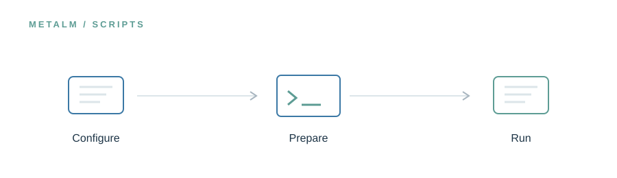

<!-- UM6P · COLLEGE OF COMPUTING · BIOINFORMATICS LABORATORY -->

# Scripts & Utilities

### The quiet infrastructure behind reproducible research.

**Research preview · Release in preparation**

<!-- --- -->

## The idea

Small, transparent utilities make research artifacts easier to prepare, inspect, and reproduce. This space is reserved for project-maintenance and reproducibility helpers, with clear inputs, outputs, and execution requirements.

> **In one line:** Setup → checks → repeatable operations.

## What will live here

Environment setup helpers, validation utilities, and maintenance scripts.

This page introduces the planned research assets. The corresponding files and software are **not yet publicly released in this folder**. Documentation, availability, and licensing will be updated alongside the release.

---

[← Explore the MetaLM project](../README.md) · [Release roadmap](../ROADMAP.md)

<!-- Research at Mohammed VI Polytechnic University (UM6P) · College of Computing · Bioinformatics Laboratory -->
